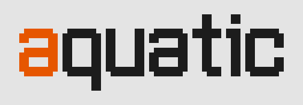

<p align="center">
  <a href="https://github.com/unaquatic/aquatic">
    <picture>
      <source media="(prefers-color-scheme: dark)" srcset="docs/logo-dark.svg">
      
    </picture>
  </a>
</p>

<p align="center">
  <a href="https://go.dev/"></a>
  <a href="https://github.com/unaquatic/aquatic/blob/main/LICENSE"></a>
</p>

<p align="center"><b>Aquatic's website, aquatic.dev, with flow's landing page, the browser of flow's model catalog, and the tool that draws the logos of flow, fluid and sqlite, written in golang.</b></p>

---

## Usage

Each page is one self-contained file, with the type16 font embedded: `index.html` is https://aquatic.dev/, `cmd/landing/index.html` is flow's landing page, https://aquatic.dev/flow/, and `cmd/catalog/index.html` is the browser of flow's model catalog, https://aquatic.dev/catalog/, which reads the `catalog.json` beside it.

```sh
go run .                     # serve aquatic.dev on http://localhost:4095
go run ./cmd/landing         # serve flow's landing page on http://localhost:4099
go run ./cmd/catalog serve   # browse the catalog that the catalog module embeds on http://localhost:4100
go run ./cmd/catalog serve -source https://aquatic.dev/catalog -refresh 1h   # or the one aquatic.dev serves
go run ./cmd/logo serve      # preview a logo's options on http://localhost:4097
go generate ./cmd/logo       # write the README logos of aquatic, flow, fluid and sqlite
```

flow, fluid and sqlite are checked out next to this repository, flow as `flowcode`. flow's tests write the frames that its landing page replays in its terminal; copy them in when they change:

```sh
(cd ../flowcode && go test ./internal/terminal/ -run LandingDemo -update)
go test ./cmd/landing -update
```

## Deploy

Every push to main is checked and released as the next semantic version, and deploys the site to https://aquatic.dev/ as the Cloudflare Worker `aquatic` (`wrangler.jsonc`): the pages, and under https://aquatic.dev/catalog/ the catalog browser with `catalog.json` and `schema.json` from the [catalog](https://github.com/unaquatic/catalog)'s latest release. Every hour, Catalog Deploy deploys the site again when the catalog has released a new version.

## License

Aquatic is released under the [MIT License](LICENSE).
